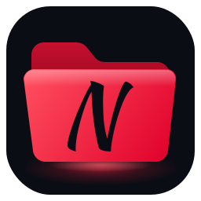
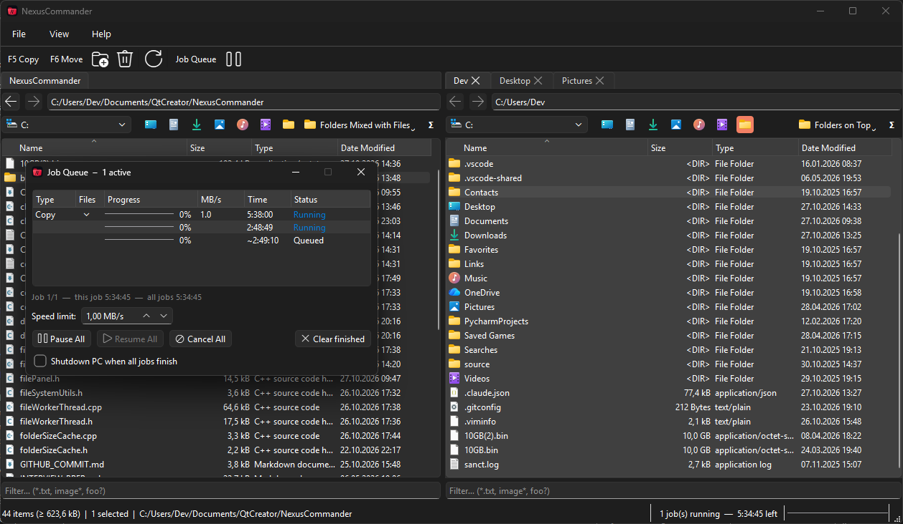

<div align="center">
  
  <h1>NexusCommander</h1>
  <p>A fast, multithreaded dual-pane file manager for Windows — inspired by Total Commander, built with Qt 6 and C++17</p>
</div>



## Features

- **Dual-pane layout** with tabbed browsing (Ctrl+T / Ctrl+W, middle-click opens a folder in a new tab)
- **F-key shortcuts** — F5 Copy, F6 Move, F7 New Folder, F8 Delete, F2 Refresh
- **Background file operations** with a Job Queue
  - Progress, speed and remaining time per file, per job and for the whole queue
  - Jobs with several files expand to one row per file
  - Pause / Resume / Cancel single jobs or the whole queue (toolbar button)
  - Conflict resolution: Overwrite, Skip, Keep Both, with "Apply to all"
  - Global speed limit (adjustable at any time, even mid-copy)
  - Progress on the taskbar button and in the status bar, also with the Job Queue closed
  - Optional "Shutdown PC when all jobs finish"
- **Network drives and shares**
  - Mapped drives and `\\server\share` locations in the drive dropdown; offline drives are greyed out
  - "Find network drives…" searches the LAN (mDNS and WS-Discovery)
  - "Connect to server…" (or typing `\\server` in the address bar) lists a server's shares
  - Shares open in the background; Windows' sign-in dialog only appears when a server asks for a login
  - Never creates drive letters, stores no credentials
- **Drive dropdown** with icons, **quick-access buttons** for user folders (Desktop, Documents, Downloads, …) and USB hot-plug detection
- **Detail view** with Name / Size / Type / Date columns — click a header to sort (natural name order); folders mixed with files, on top or at the bottom (per tab)
- **Folder sizes on request** — Space, the Σ button, or the info bar shown when sorting by size; calculated in the background, Esc cancels. Subfolders get their sizes from the same walk, shared across tabs for the session; totals in the status bar
- **Safe file operations**
  - Free-space check before a copy / move writes anything
  - Moving a folder onto an existing one merges them, like Explorer
  - Read-only files are never deleted or moved without asking
  - Junctions and symlinks are never followed
  - Cross-volume moves copy first and delete the source only after a verified copy
  - Cancelling aborts hung network I/O immediately
- **Clipboard integration** — Ctrl+C / Ctrl+X / Ctrl+V interoperates with Windows Explorer
- **Filter bar** (Ctrl+S) — wildcard filtering (e.g. `*.txt`, `image*`)
- **Hide .part files** (View menu, on by default) — also skipped when copying / moving
- **Open Terminal Here** — Windows Terminal, else PowerShell
- **Navigation history** — Back / Forward buttons, mouse thumb buttons, Alt+Left/Right

## Download

Pre-built Windows binaries are available on the [Releases](../../releases) page — no Qt installation required.

## Build from Source

### Requirements

- **Windows 10 / 11** (uses Win32 APIs for drives, network shares and the taskbar)
- **Qt 6.x** with the Widgets, Concurrent and Network modules (install via [qt.io/download-open-source](https://www.qt.io/download-open-source))
- **CMake 3.18+**
- **C++17** compiler (MSVC or MinGW)

### Option 1 — Qt Creator

Open `CMakeLists.txt` in Qt Creator, select your Kit, and build. Works with both MinGW and MSVC kits. This is the recommended way to build with MinGW — Qt Creator sets up the compiler and Qt for you.

### Option 2 — Visual Studio (MSVC)

If Qt is installed to the default location (`C:\Qt\`), CMake **auto-detects** the newest MSVC kit:

```bash
git clone https://github.com/Kmorkel/NexusCommander.git
cd NexusCommander
cmake -B build
cmake --build build --config Release
```

If Qt is installed elsewhere, point to it explicitly:

```bash
cmake -B build -DCMAKE_PREFIX_PATH="D:/Qt/6.x.x/msvc2022_64"
```

Or set the environment variable `QT_ROOT` or `QTDIR` before running CMake.

### Deployment

After a build, `CMakeLists.txt` runs `windeployqt` as a post-build step:

- **MSVC** (every configuration) — the Qt DLLs and plugins are copied next to `NexusCommander.exe`, so it runs and debugs straight from Visual Studio or Qt Creator:
  - **Debug** gets the debug DLLs (`Qt6Cored.dll`, `Qt6Widgetsd.dll`, …) — a debug build cannot run or be debugged with the release DLLs.
  - **Release / MinSizeRel / RelWithDebInfo** get the release DLLs (`Qt6Core.dll`, …).

  The build folder also contains CMake files, and the Visual C++ runtime is only included as the `vc_redist.x64.exe` installer — so for distribution, use the MinGW `deploy/` folder below.
- **MinGW** (every configuration except Debug) — a self-contained copy is assembled in a `deploy/` folder inside the build folder, including the MinGW runtime DLLs:

```
<build folder>/deploy/
 ├── NexusCommander.exe
 ├── Qt6Core.dll, Qt6Gui.dll, Qt6Widgets.dll, Qt6Network.dll, ...
 ├── platforms/, styles/, imageformats/, ...
 └── libgcc_s_seh-1.dll, libstdc++-6.dll, libwinpthread-1.dll
```

This folder runs on any Windows machine without a Qt installation — zip it up and ship it. MinGW Debug builds are not deployed (Qt's MinGW packages ship no debug plugins); Qt Creator sets `PATH` itself when debugging.

## Keyboard Shortcuts

| Key | Action |
|-----|--------|
| F2 | Refresh |
| F5 | Copy to other panel |
| F6 | Move to other panel |
| F7 | New Folder |
| F8 / Del | Delete |
| Tab | Switch between panels |
| Ctrl+T | New Tab |
| Ctrl+W | Close Tab |
| Ctrl+C / Ctrl+X | Copy / Cut to clipboard |
| Ctrl+V | Paste from clipboard |
| Ctrl+S | Focus filter bar |
| Ctrl+A | Select all |
| Backspace | Go to parent directory |
| Space | Calculate size of the selected folder(s) |
| Alt+Shift+Enter | Calculate all folder sizes |
| Esc (file list) | Cancel folder size calculation |
| Alt+Left / Right | Back / Forward |
| Middle-click (file list) | Open folder in new tab |
| Middle-click (tab bar) | Close tab |

## Architecture

```
MainWindow
 +-- QSplitter
 |    +-- QTabWidget (left)    -- one or more FilePanel tabs
 |    +-- QTabWidget (right)   -- one or more FilePanel tabs
 +-- FileWorkerThread          -- background thread, sequential job processing
 +-- JobQueueWidget            -- non-modal dialog showing the JobModel
 +-- FolderSizeCache           -- folder sizes shared by all tabs (memory only)
 +-- TaskbarProgress           -- progress on the taskbar button
```

- **FilePanel** — address bar, drive dropdown, quick-access buttons, QTreeView detail view (QFileSystemModel + filter/sort proxy), filter bar
- **FileWorkerThread** — owns the job queue on a dedicated QThread. Copies via `CopyFileExW`, or in throttled chunks when a speed limit is set; pause / resume via QWaitCondition
- **JobModel** — tree model (QAbstractItemModel) that owns all job state; the view never touches items directly
- **DriveScanner / NetworkDiscovery / ConnectServerDialog** — drive scan, LAN search and share listing, always off the GUI thread

All worker-to-UI communication goes through queued signal/slot connections. Conflict resolution intentionally blocks the worker thread via QWaitCondition until the user responds.

## Documentation

All public classes and methods carry Doxygen-style comments. If you have [Doxygen](https://www.doxygen.nl/) installed, you can generate an HTML reference from the source:

```bash
doxygen -g Doxyfile      # once: create a default config
doxygen Doxyfile         # generate HTML under html/index.html
```

## License

NexusCommander is licensed under the [MIT License](LICENSE).

### Third-Party

NexusCommander uses the [Qt Framework](https://www.qt.io/) (v6), licensed under the [LGPL v3](https://www.gnu.org/licenses/lgpl-3.0.html). Qt is linked dynamically — no modifications were made to the Qt source code, and the Qt DLLs can be replaced by compatible versions. The license texts are in [LICENSES/](LICENSES). The Qt source code is available at [qt.io/download-open-source](https://www.qt.io/download-open-source).